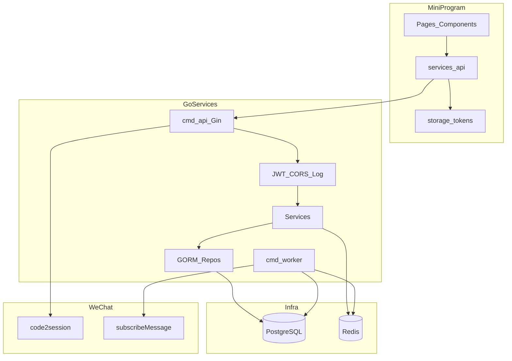
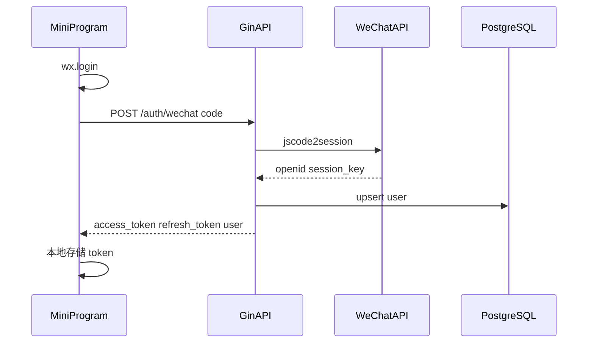
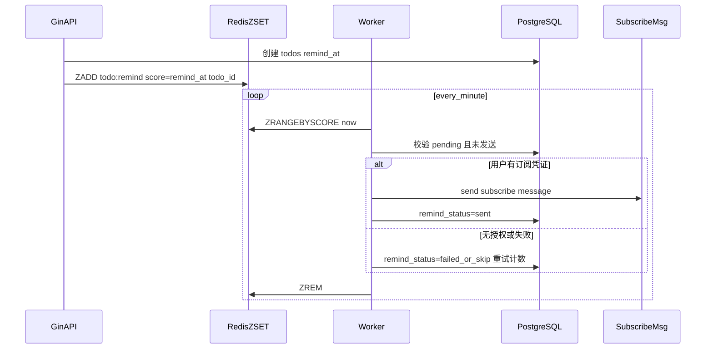
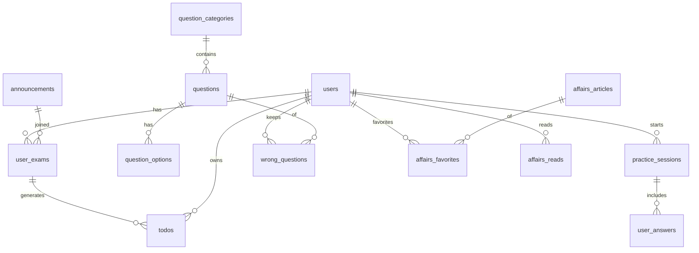

# 公考微信小程序 — 开发方案

| 项 | 内容 |
|---|---|
| 文档版本 | v1.0 |
| 依据文档 | [需求文档.md](./需求文档.md) v1.0 |
| 文档状态 | 初稿 |
| 适用范围 | 完整版（M1～M4） |

---

## 1. 方案目标与原则

### 1.1 目标

在满足 PRD 全部 P0 需求的前提下，落地可运行的 monorepo：微信原生小程序 + Go API + Worker + PostgreSQL/Redis，按里程碑可演示、可联调、可部署。

### 1.2 设计原则

1. **前后端分离**：小程序只调 REST；鉴权统一 JWT。
2. **读写清晰**：C 端读多写少；采集/提醒走独立 Worker，避免拖慢 API。
3. **配置外置**：微信密钥、模板 ID、采集源、数据库均环境变量 / 配置文件。
4. **幂等优先**：登录、加入考试、采集去重、提醒发送均需幂等。
5. **合规最小采集**：公告/时政优先摘要 + 原文链接；失败可人工补录。
6. **先打通主路径**：M1 登录壳 → M2 公告代办提醒 → M3 刷题 → M4 时政打磨。

---

## 2. 总体架构

### 2.1 逻辑架构



### 2.2 进程划分

| 进程 | 入口 | 职责 |
|---|---|---|
| API | `server/cmd/api` | HTTP、鉴权、业务写读、管理接口 |
| Worker | `server/cmd/worker` | 公告/时政采集、代办提醒扫描发送、补偿任务 |
| PostgreSQL | Docker | 主数据 |
| Redis | Docker | 提醒 ZSET、缓存、分布式锁（可选） |

开发期可用同一 compose 拉起；生产可拆分副本与独立 Worker。

### 2.3 请求链路（登录）



### 2.4 代办提醒链路



---

## 3. 技术选型明细

| 层级 | 技术 | 说明 |
|---|---|---|
| 小程序 | 原生 + TypeScript（或 JS，首期可用 JS 加速） | 微信开发者工具；建议 TS |
| UI | 原生组件 + 少量自定义样式 | 不引入重型 UI 库，控制包体积 |
| 后端 | Go 1.22+ / Gin | 路由、中间件 |
| ORM | GORM + postgres driver | AutoMigrate 开发期；生产可用 SQL 迁移工具 |
| 鉴权 | golang-jwt | access 2h、refresh 30d（可配） |
| Redis | go-redis | ZSET 提醒、可选公告列表缓存 |
| 配置 | env + `spf13/viper` 或纯 env | 十二要素 |
| 定时 | `robfig/cron` 或自研 ticker | Worker 内 |
| 采集 | `net/http` + goquery（HTML）/ 标准 XML（RSS） | 源可插拔 |
| 部署 | Docker Compose | postgres、redis、api、worker |
| 日志 | slog 或 zap | JSON 结构化 |
| 接口文档 | 手写 `docs/API.md`；可选 swag | M1 后补充 |

**明确不做**：GraphQL、微服务拆分、消息中间件（Kafka 等）——本期 Redis 足够。

---

## 4. 仓库与目录结构

```
gongkao/
  docs/
    需求文档.md
    开发方案.md          # 本文
    API.md               # 实现阶段补充
  deploy/
    docker-compose.yml
    nginx/               # 可选反向代理
  server/
    cmd/
      api/main.go
      worker/main.go
    internal/
      config/
      model/             # GORM models
      repo/              # 数据访问
      service/           # 业务
      handler/           # HTTP
      middleware/
      wx/                # 微信 SDK 封装
      crawler/           # 公告/时政采集
      worker/            # 提醒与调度
      pkg/               # 错误码、响应、分页
    migrations/          # 可选 SQL
    go.mod
    go.sum
  miniapp/
    app.json
    app.ts
    app.wxss
    project.config.json
    pages/
      home/
      announcement/
      practice/
      affairs/
      mine/
    services/
      api.ts
      auth.ts
    utils/
    components/
  scripts/
    seed_questions.json  # 题库种子
    import_questions.go  # 或 admin API 导入
  README.md
```

---

## 5. 数据库设计方案

### 5.1 ER 关系（核心）



### 5.2 表设计要点

#### users

| 字段 | 类型 | 说明 |
|---|---|---|
| id | bigserial PK | |
| openid | varchar unique | |
| unionid | varchar null | |
| nickname | varchar | |
| avatar_url | varchar | |
| session_key_enc | varchar/text | 加密存储，可空 |
| created_at / updated_at | timestamptz | |

#### announcements

| 字段 | 类型 | 说明 |
|---|---|---|
| id | bigserial PK | |
| type | varchar | `civil` / `institution` |
| title | varchar | |
| region | varchar | 省/市编码或名称 |
| source | varchar | 采集源标识 |
| source_id | varchar | 源内唯一 ID |
| source_url | varchar | 原文 |
| summary | text | |
| content | text | 可选 |
| register_start / register_end | timestamptz null | |
| confirm_start / confirm_end | timestamptz null | |
| exam_at | timestamptz null | |
| published_at | timestamptz | |
| status | varchar | `draft` / `published` / `offline` |
| unique(source, source_id) | | 去重 |

#### user_exams

`id, user_id, announcement_id, created_at`，`unique(user_id, announcement_id)`。

#### todos

| 字段 | 类型 | 说明 |
|---|---|---|
| id | bigserial | |
| user_id / user_exam_id / announcement_id | bigint | 冗余 announcement_id 便于分组查询 |
| type | varchar | register/confirm/exam/custom |
| title | varchar | |
| due_at | timestamptz | |
| remind_at | timestamptz | due_at - 10m |
| status | varchar | pending/done/cancelled |
| remind_status | varchar | pending/sent/skipped/failed |
| remind_retry | int | |
| last_remind_error | text null | |

索引：`(user_id, status, due_at)`、`(remind_status, remind_at)`。

#### 刷题相关

- `question_categories`：name, sort, status
- `questions`：category_id, stem, type(`single`), answer_key, analysis, difficulty, tags[]
- `question_options`：question_id, key(A/B/C/D), content, sort
- `practice_sessions`：user_id, mode, category_id, total, correct, status, started_at, finished_at
- `user_answers`：session_id, question_id, user_key, is_correct
- `wrong_questions`：user_id, question_id, wrong_count, last_wrong_at, mastered_at null；unique(user_id, question_id)

#### 时政相关

- `affairs_articles`：title, source, source_url, summary, content, tags, published_at, status
- `affairs_favorites`：user_id, article_id, unique
- `affairs_reads`：user_id, article_id, read_at

#### 其他

- `admin_users`：username, password_hash, role
- `crawl_failures`：source, url, error, payload, created_at
- `user_subscribe_prefs`（可选）：user_id, template_scene, authorized_at —— 若仅依赖微信侧一次性订阅，可先不建表，发送失败码区分

### 5.3 迁移策略

- 开发：GORM `AutoMigrate`。
- 上线前：导出 SQL 或引入 `golang-migrate`，Worker/API 启动不做破坏性变更。

---

## 6. 后端模块设计

### 6.1 分层

`handler → service → repo → model`  
跨域能力：`internal/wx`（登录、access_token、订阅消息）、`internal/crawler`、`internal/worker`。

### 6.2 统一响应与错误码

```json
{ "code": 0, "message": "ok", "data": {} }
```

| code | 含义 |
|---|---|
| 0 | 成功 |
| 40001 | 参数错误 |
| 40101 | 未登录 / token 无效 |
| 40301 | 无权限 |
| 40401 | 资源不存在 |
| 40901 | 冲突（如重复） |
| 50001 | 内部错误 |
| 50010 | 微信接口错误 |

### 6.3 鉴权中间件

- 解析 `Authorization: Bearer`，校验 access JWT，注入 `user_id`。
- `/admin/*`：校验 admin JWT 或 Basic + 独立签发 token（建议：管理员账号密码登录换 admin JWT）。
- 公开接口：公告列表/详情、时政列表/详情、分类列表。

### 6.4 核心 Service 职责

| Service | 职责 |
|---|---|
| AuthService | code2session、upsert 用户、签发双 token、refresh |
| AnnouncementService | 列表筛选、详情、管理 CRUD、上架 |
| ExamService | 加入/移除我的考试；调用 TodoService 生成/取消 |
| TodoService | 生成规则、状态变更、写入 Redis ZSET、公告时间同步 |
| PracticeService | 组卷、交卷判分、错题写入、统计 |
| AffairsService | 列表详情、收藏、阅读 |
| AdminImportService | 题目 JSON/CSV 导入 |
| ReminderService | Worker 侧取任务、调微信发送、更新状态、补偿扫描 |
| CrawlerService | 按源拉取、解析、去重入库、失败落库 |

### 6.5 代办生成算法（实现契约）

```
on JoinExam(user, announcement):
  create user_exam if not exists
  for each rule in [register, confirm, exam]:
    due = resolve_due(announcement, rule)  // end 优先，否则 start；exam 用 exam_at
    if due == null: continue
    upsert todo (user, exam, type) where status != cancelled
      due_at = due
      remind_at = due - 10m
      status = pending
      remind_status = pending
    Redis ZADD remind_at -> todo_id
```

移除考试：相关 `pending` 代办 → `cancelled`，ZREM。

### 6.6 微信封装

| 方法 | 说明 |
|---|---|
| Code2Session(code) | 登录 |
| GetAccessToken() | 稳定版或缓存 access_token（Redis，提前刷新） |
| SendSubscribeMessage(openid, templateId, data, page) | 提醒 |

开发无真 AppID 时：`WX_MOCK=true`，登录返回固定 openid，发送只打日志。

---

## 7. 采集方案

### 7.1 架构

- 接口：`Crawler` 定义 `Name() / Fetch() ([]RawItem, error)`。
- 注册表按配置启用源。
- 调度：cron（如每 30～60 分钟）。
- 入库：映射为 `announcements` / `affairs_articles`；冲突则更新标题与时间字段（可配置）。

### 7.2 首期源策略

| 类型 | 策略 |
|---|---|
| 公告 | 优先 RSS/列表页结构化好的公开源 1～2 个；解析标题、链接、时间；关键时间线能抽则抽，否则留空靠人工补 |
| 时政 | 公开时政摘要 RSS 或白名单站点列表页 |
| 失败 | 写入 `crawl_failures`，不中断其他源 |

### 7.3 合规

- User-Agent 标识；限频；不存全文版权敏感内容时仅 summary + URL。
- README/运维文档注明源配置责任。

---

## 8. 小程序端方案

### 8.1 工程要点

- `app.json` 配置 TabBar 四页；分包可选（刷题/时政）控制主包。
- `services/api.ts`：封装 `request`，自动带 token；401 清 token 并跳转登录。
- `services/auth.ts`：`ensureLogin()` 封装 wx.login → 后端。
- 本地存储：`access_token`、`refresh_token`、用户资料。

### 8.2 页面与接口映射

| 页面 | 主要 API |
|---|---|
| 首页 | `GET /announcements` |
| 公告详情 | `GET /announcements/:id`，`POST /me/exams` |
| 我的考试 | `GET/DELETE /me/exams` |
| 我的代办 | `GET /me/todos`，`PATCH /me/todos/:id`，订阅引导 |
| 刷题 | `GET /questions/categories`，`POST /practice/sessions`，`POST /practice/submit` |
| 错题本 | `GET/DELETE /me/wrong-questions` |
| 时政 | `GET /affairs`，`GET /affairs/:id`，收藏 API |
| 我的 | 本地用户信息 + 入口 |

### 8.3 订阅消息 UX

1. 加入考试成功 Toast 后，弹窗说明「开启提醒」。
2. 用户确认 → `wx.requestSubscribeMessage({ tmplIds: [...] })`。
3. 授权结果可选上报后端（便于统计）；发送仍以微信侧为准。
4. 设置页重复引导。

### 8.4 UI 约束（本期）

- 简洁政务备考风：主色沉稳蓝/墨绿，避免花哨营销风。
- 列表性能：分页、骨架屏；详情长文富文本用 `rich-text` 或 Madown 转节点（若存 Markdown）。

---

## 9. API 设计约定

### 9.1 通用

- Prefix：`/api/v1`
- 分页：`page`（从 1）、`page_size`（默认 20，最大 50）
- 列表 data：`{ list, total, page, page_size }`
- 时间：ISO8601 UTC 或统一 RFC3339；小程序展示转本地时区

### 9.2 模块清单（与 PRD 一致）

详见需求文档第 6 章；实现时输出 `docs/API.md` 补齐请求/响应 JSON Schema。

### 9.3 管理端

- `POST /admin/login`
- 公告/题目/时政 CRUD
- `POST /admin/questions/import`（multipart 或 JSON body）
- `GET /admin/crawl-failures`

---

## 10. 部署与环境

### 10.1 docker-compose 服务

| 服务 | 镜像/构建 | 端口 |
|---|---|---|
| postgres | postgres:16 | 5432 |
| redis | redis:7 | 6379 |
| api | build `server` | 8080 |
| worker | 同代码不同 cmd | 无对外端口 |

### 10.2 环境变量

```
APP_ENV=dev
HTTP_ADDR=:8080
DATABASE_URL=postgres://...
REDIS_URL=redis://...
JWT_SECRET=...
JWT_ACCESS_TTL=2h
JWT_REFRESH_TTL=720h
WX_APPID=...
WX_SECRET=...
WX_MOCK=true
WX_SUBSCRIBE_TEMPLATE_TODO=...
WX_SUBSCRIBE_TEMPLATE_AFFAIRS=...
CRAWLER_ENABLED=true
SESSION_KEY_AES_KEY=...   # 32 bytes
ADMIN_BOOTSTRAP_USER=...
ADMIN_BOOTSTRAP_PASS=...
```

### 10.3 小程序配置

- 开发：不校验合法域名；`baseURL` 指向本机/局域网 API。
- 体验/正式：配置 request 合法域名；关闭 MOCK；配置订阅模板 ID 与 PRD 文案一致。

---

## 11. 安全方案

1. HTTPS 生产全站；密钥不入库不进仓库。
2. JWT secret 足够长；refresh 可存 Redis 黑名单（登出，P1）。
3. Admin 密码 bcrypt；接口限流（IP + user，P1 可用 Redis）。
4. 采集出口与业务 API 同机时注意 SSRF：禁止用户自定义任意 crawl URL（仅配置源）。
5. 用户输入长度限制；富文本 XSS：小程序 `rich-text` 白名单标签。

---

## 12. 测试与质量

| 类型 | 范围 |
|---|---|
| 单元测试 | Todo 生成规则、判分、去重 key、时间 remind_at |
| 接口测试 | httptest 登录、公告、加入考试、交卷 |
| Worker 测试 | Redis ZSET + mock 微信发送 |
| 小程序 | 开发者工具手测清单按 PRD 验收要点 |
| 回归 | 每里程碑 demo 脚本 / curl 集合 `scripts/smoke.sh` |

覆盖率不设硬指标；**P0 路径必须可自动化或一键手工脚本验证**。

---

## 13. 里程碑实施计划

### M1 — 骨架与登录（约 1 周）

**任务：**

1. 初始化 monorepo、`deploy/docker-compose.yml`、README。
2. Go module、Gin 健康检查、配置加载、GORM 连接、`users` 表。
3. Auth：微信登录（含 MOCK）、JWT、中间件、`GET /me`。
4. 小程序：TabBar 四页壳、`api`/`auth` 封装、登录按钮联调。

**完成标准：** 模拟/真机登录成功，带 token 访问 `/me`。

### M2 — 公告与代办提醒（约 1.5 周）

**任务：**

1. 公告模型、C 端列表详情、Admin CRUD。
2. 首个采集器 + cron + crawl_failures。
3. 我的考试、代办生成/取消、代办列表与 PATCH。
4. Redis ZSET + Reminder Worker + 订阅消息（MOCK/真）。
5. 小程序：首页、详情、我的考试、我的代办、订阅引导。

**完成标准：** 加入考试后生成代办；改系统时间或注入 `remind_at` 可看到发送日志/真推送。

### M3 — 刷题（约 1.5 周）

**任务：**

1. 题库表、种子数据、导入 API。
2. 开始练习、交卷、错题本、统计接口。
3. 小程序：分类、答题、结果、错题本。

**完成标准：** 完整走通一套练习并写入错题与统计。

### M4 — 时政与打磨（约 1 周）

**任务：**

1. 时政表、采集/发布、收藏阅读。
2. 可选每日推送开关。
3. 性能与日志、冒烟脚本、API 文档、配置说明收尾。

**完成标准：** PRD P0 清单可逐条勾选；P1 推送可演示或明确开关关闭。

---

## 14. 人员与协作建议（若单人则按序）

| 角色 | 侧重 |
|---|---|
| 后端 | API、模型、Worker、采集 |
| 前端 | 小程序页面与联调 |
| 兼岗 | 订阅消息模板申请、域名、Docker |

协作节奏：每里程碑结束固定 Demo；接口变更先改 `docs/API.md`。

---

## 15. 风险对策（研发视角）

| 风险 | 方案落点 |
|---|---|
| 无 AppID | `WX_MOCK` 贯穿登录与发送 |
| 模板未审过 | Worker 记 `skipped`；逻辑仍可测 |
| 采集源不稳定 | 插件化 + 人工 CRUD 兜底 |
| 提醒漏发 | Worker 启动补偿：DB 扫 `remind_at<=now AND remind_status=pending` |
| 包体积 | 分包；图片压缩；避免大库 |

---

## 16. 交付物清单

| 交付物 | 路径 |
|---|---|
| 需求文档 | `docs/需求文档.md` |
| 开发方案 | `docs/开发方案.md` |
| API 文档 | `docs/API.md`（实现中产出） |
| 后端代码 | `server/` |
| 小程序代码 | `miniapp/` |
| 部署 | `deploy/docker-compose.yml` |
| 种子/脚本 | `scripts/` |
| 说明 | 根目录 `README.md` |

---

## 17. 下一步

方案评审通过后，按 **M1** 开工：创建目录骨架、docker-compose、Go API 健康检查与微信登录（MOCK）、小程序 TabBar 与登录联调。

---

## 修订记录

| 版本 | 日期 | 说明 |
|---|---|---|
| v1.0 | 2026-10-09 | 初稿，对齐需求文档 v1.0 |
| v1.1 | 2026-10-09 | 本地无 Docker 时支持 `sqlite:` DSN 冒烟（生产仍用 PostgreSQL） |
